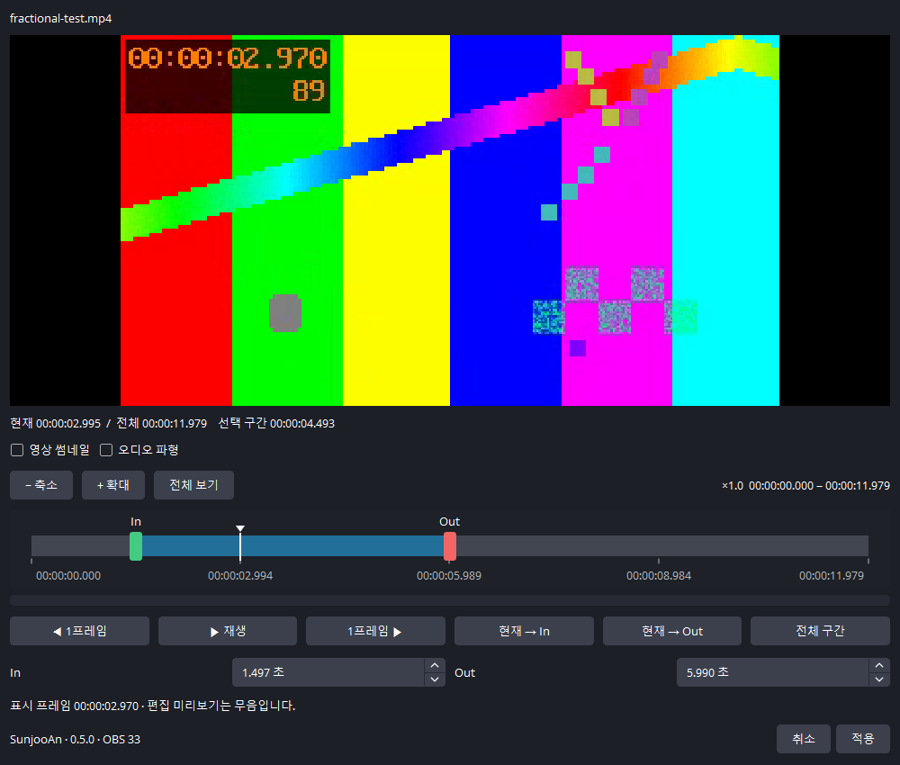
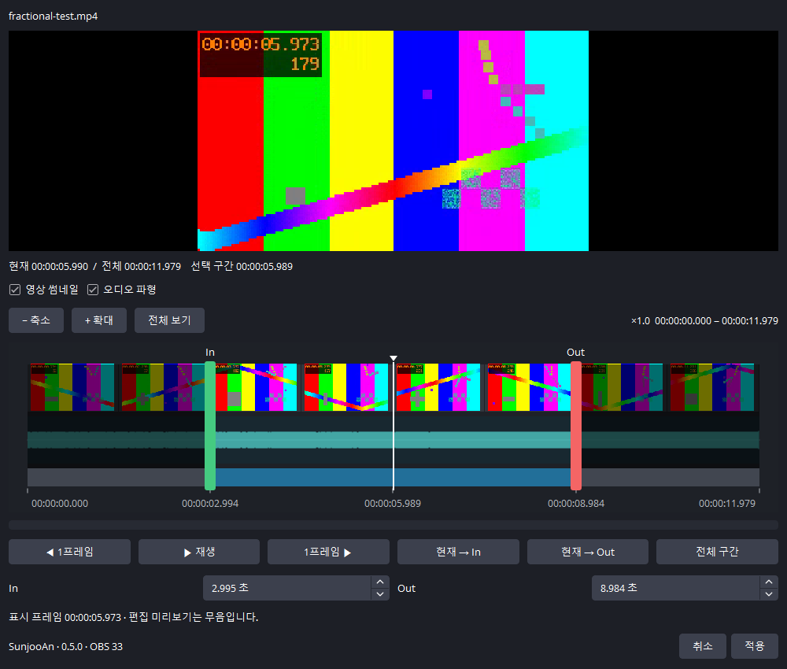

# Sunjoo Media Cue Control 0.5.0

[English](README.en.md) · 제작자: **SunjooAn** · Windows x64 · GPL-2.0-or-later

OBS 기본 **미디어 소스**에 추가하는 재생 제어 필터입니다. 탐색기에서 영상을 OBS로 드래그하는 기존 방식을 그대로 사용합니다. 전용 Sunjoo Media Cue 소스와는 별도 플러그인이며 둘을 함께 설치해도 됩니다.

## 다운로드

[최신 릴리스와 설치 파일](https://github.com/sunjoo1968-design/sunjoo-media-cue-control/releases/latest)에서 OBS 버전에 맞는 Windows x64 ZIP을 받으세요. OBS 32용은 **32.2.2 기준**, OBS 33용은 **33.0.0 기준**입니다. 설치 ZIP과 전체 소스, SHA-256 체크섬을 함께 제공합니다.

현재 공개 버전은 **0.5.0**입니다. 프로그램·프리뷰 밖 미디어의 **디코더 메모리 자동 해제는 다음 버전으로 보류**했으며 현재 릴리스에는 포함하지 않았습니다. [다음 버전 계획](ROADMAP.md)을 참조하세요.

## 설치와 사용

1. 사용 중인 OBS 버전에 맞는 ZIP 전체를 압축 해제합니다. OBS 33.0.0용과 OBS 32.2.2 기준 빌드를 구분했습니다.
2. OBS를 종료하고 `Install-SunjooMediaCueControl.cmd`를 관리자 권한으로 실행합니다. 기본 설치 경로는 `C:\Program Files\obs-studio`입니다.
3. 다른 경로나 포터블 OBS는 관리자 PowerShell에서 `& .\Install.ps1 -ObsRoot 'D:\OBS'`처럼 지정합니다. OBS 33용은 ProgramData 플러그인 경로에 설치합니다.
4. OBS를 실행하고 **스튜디오 모드**를 켭니다.
5. MP4·MOV·WebM 등을 탐색기에서 OBS로 드래그해 기본 **미디어 소스**를 만듭니다.
6. 해당 소스 → **필터** → **오디오/비디오 필터**의 `+` → **Sunjoo Media Cue Control**을 선택합니다. 각 미디어 소스에 하나씩 추가합니다.
7. 장면을 프리뷰에 올리고 In 지점 준비가 완료된 뒤 전환합니다. 처음 추가했을 때는 In 0 / Out 0으로 전체 영상을 재생합니다.

필터 속성·구간 편집창·DLL 버전 정보에 **SunjooAn / 0.5.0 / 대상 OBS 버전**을 표시합니다. 별도 도구 메뉴나 제작자 팝업은 생성하지 않습니다. 제작자 표기는 인증서 기반 Authenticode 서명과 다릅니다. 기존 v0.1.0~0.4.0과 필터 ID가 같아 업데이트 시 기존 장면의 필터와 저장한 In/Out을 그대로 사용합니다.

## 영상을 보면서 타임라인으로 구간 선택

1. 필터 속성에서 **영상 보면서 구간 편집…**을 누릅니다.
2. 별도 편집창에서 **녹색 In 손잡이**와 **빨간색 Out 손잡이**를 드래그합니다. 선택 구간이 파란색으로 표시됩니다.
3. 타임라인의 빈 곳을 클릭·드래그하면 흰색 재생 헤드를 옮기며 해당 프레임을 확인할 수 있습니다.
4. **이전/다음 1프레임**, **재생/일시정지**, **현재 → In/Out**, **전체 구간**을 사용할 수 있습니다. 편집창 안의 재생은 선택 구간에서만 동작하며 항상 무음입니다.
5. 숫자 입력과 손잡이는 서로 동기화됩니다. **적용**하면 저장하고 창을 닫으며, **취소**하거나 창을 닫으면 변경하지 않습니다.

편집창을 열면 **영상 썸네일 / 오디오 파형 체크가 모두 해제**되어 편집 바만 표시됩니다. 원하는 항목을 체크하면 해당 행이 나타납니다. 두 옵션은 독립적으로 선택하며, 새 창에서는 다시 기본 숨김 상태로 시작합니다. 숨긴 항목은 생성·분석 작업도 취소하고 캐시를 비웁니다. **+ 확대 / − 축소** 버튼 또는 **Ctrl+마우스 휠**로 재생 헤드 주변을 확대·축소합니다. 확대하면 시간 눈금과 손잡이의 픽셀당 시간 간격이 함께 세밀해집니다. 아래쪽 **가로 이동 막대** 또는 Ctrl 없이 마우스 휠로 확대 구간을 이동하고, **전체 보기**로 처음 화면에 돌아옵니다. 최소 표시 폭은 약 8프레임입니다. 썸네일이나 타임라인의 빈 곳을 클릭·드래그하면 해당 영상을 확인할 수 있습니다.

v0.4.0은 29.97fps 등에서 **이전 1프레임**이 같은 화면을 다시 보여주던 문제를 수정했습니다. 밀리초를 1만큼 빼는 대신 디코딩된 실제 프레임 시각을 비교해 이전 프레임을 선택합니다. 영상 시작에서는 더 뒤로 이동하지 않으며, 영상 끝에서는 다음 프레임이 유지됩니다.

기본 화면 — 썸네일·파형 숨김:



옵션 표시 화면:



편집창은 원본 프로그램 소스와 별도인 영상 FFmpeg 디코더와 선택적 오디오 분석기를 사용합니다. OBS 소스·오디오 믹서를 추가하지 않으며, 편집창에서 탐색·재생·취소해도 프로그램의 영상과 오디오를 조작하지 않습니다. 프로그램에서 이미 재생 중이면 **적용**도 현재 재생이나 반복 설정을 바꾸지 않고 다음 프리뷰 준비·프로그램 진입부터 새 구간을 사용합니다. 원본 파일이나 필터가 편집 중 변경되면 적용을 거부하여 다른 파일에 구간을 저장하지 않습니다.

편집창의 표시 프레임은 키프레임부터 목표 시각까지 별도 디코딩합니다. 최대 960×540으로 미리보기를 만들고 최신 탐색 요청을 우선 처리하여 전체 영상을 메모리에 올리지 않습니다. 창을 닫으면 디코더와 작업 스레드를 종료합니다. 로컬 SDR 영상이 대상이며 HDR 편집 미리보기는 지원하지 않습니다. 최종 OBS 재생 구간 경계는 기존 미디어 소스의 프레임·처리 주기에 따릅니다.

썸네일은 160×90 이내 크기로 만들고 최대 64장만 메모리에 보관합니다. 확대·이동한 구간에 맞춰 다시 생성하며 편집 영상 탐색을 썸네일 생성보다 우선합니다. Windows 편집 작업 스레드는 낮은 우선순위로 실행하고 영상 디코더는 한 스레드를 사용합니다. 여러 편집창의 영상 디코딩은 한 번에 하나, 파형 분석도 한 번에 하나로 제한합니다. 파일의 해상도·GOP 간격·PC 성능에 따라 썸네일이 나타나는 데 시간이 걸릴 수 있습니다.

## 오디오 파형과 방송 중 편집

**오디오 파형**을 체크하면 청록색 파형이 표시됩니다. 앞뒤 무음과 소리의 시작·끝을 보면서 기존 In/Out 손잡이를 끌면 됩니다. 영상 썸네일 없이 파형만 켜도 됩니다. 확대·이동하면 보이는 구간을 다시 분석하므로 좁은 구간을 세밀하게 확인할 수 있습니다. 분석 중에도 편집 바와 영상 탐색은 사용할 수 있습니다. 오디오 트랙이 없으면 해당 문구를 표시합니다.

파형은 모든 채널의 절댓값 최대 진폭입니다. 반대 위상의 스테레오도 상쇄시키지 않습니다. 작은 소리를 잘 볼 수 있도록 표시 높이에 제곱근 스케일을 사용하며, 음량계나 dB 눈금은 아닙니다. 한 구간당 최대 32,768개 피크(128KiB)를 저장합니다. 32.768초 이하의 보기에서는 약 1ms 간격, 긴 보기에서는 더 넓은 간격으로 요약하며 확대하면 다시 세밀하게 분석합니다. 최종 재생 경계는 OBS 프레임·오디오 처리 주기에 따릅니다.

파일 분석은 OBS 소스·믹서와 연결하지 않으며 소리를 출력하지 않습니다. 창이 닫혀 있으면 편집 디코더·썸네일·파형 작업 자체가 없습니다. 다수의 미디어에 필터를 붙여도 각각 별도 편집 디코더를 상시 실행하지 않습니다. 옵션을 끄거나 창을 닫으면 작업을 취소합니다.

**64개 필터를 적용해 두고 고해상도 4개를 재생하는 조건**의 검증과 메모리 특성은 [방송 운용 검토](BROADCAST-REVIEW.md)를 참조하세요. 필터는 기존 OBS 미디어 디코더를 사용하고 프리뷰 준비를 위해 `close_when_inactive`를 해제하므로, 사용했던 파일의 디코더 메모리가 남을 수 있습니다. 대기 필터 개수와 동시 디코딩 개수, 보유 메모리는 서로 다른 지표입니다.

## In / Out 구간 선택

필터 속성의 **In 시작 지점 (초)**과 **Out 종료 지점 (초)**에 파일 시작 기준 시간을 입력합니다. 예를 들어 In `10.500`, Out `25.000`은 10.5초부터 25초까지만 재생합니다. 밀리초 단위로 값을 입력할 수 있지만 실제 영상은 해당 파일의 사용 가능한 프레임과 OBS 처리 주기에 맞춰집니다. 오디오 샘플 단위의 편집 기능이 아닙니다.

- **In 0 / Out 0**: 전체 영상. Out 0은 파일 끝을 뜻합니다.
- **현재 재생 위치를 In으로 / Out으로**: 프로그램에서 재생 중인 현재 위치를 저장합니다. 변경한 구간은 다음 프리뷰 준비·프로그램 진입에 적용합니다.
- **구간 초기화**: In과 Out을 모두 0으로 돌립니다.
- **상태 새로고침**: 준비 중·프리뷰 대기·Out 도달·화면 이탈 정지·구간 오류 상태 문구를 확인합니다. 상태 문구는 이 버튼으로 갱신하는 스냅샷이며 실제 재생 제어는 자동입니다.

프리뷰에서는 In 지점에서 정지하고, 전환이 시작되면 그 위치에서 재생합니다. Out에 도달하면 화면을 유지하면서 재생과 오디오를 멈춥니다. 프로그램에서 빠져 프리뷰로 돌아오면 In 지점을 다시 준비합니다. Out은 In보다 커야 하고 In은 파일 길이보다 짧아야 합니다. 잘못된 구간은 재생하지 않고 오류를 표시합니다. 파일 길이보다 긴 Out은 파일 끝으로 제한합니다.

일부 파일은 탐색 시 In보다 앞의 키프레임으로 이동합니다. 필터는 이때 소리를 차단한 상태로 In까지 준비합니다. 준비 중에는 화면이 갱신될 수 있으며, GOP 간격이 긴 파일은 준비 시간이 더 걸릴 수 있습니다. **상태 새로고침 → 프리뷰 대기**를 확인한 후 전환하세요. 구간 사용 중에는 파일 전체 반복을 해제하여 Out 정지를 우선합니다. Out에 도달한 뒤 다시 재생하려면 장면을 프리뷰로 되돌려 재준비합니다.

## 동작

- 프리뷰에 표시되는 미디어: In 지점(기본 0)의 프레임에서 정지하고 프리뷰 오디오를 차단합니다.
- CUT·페이드 등으로 프로그램에 진입: 전환이 진행되는 동안 재생을 시작합니다. OBS 영상 처리 주기에 따라 한두 프레임 정도의 명령 처리 시간이 있습니다.
- 프로그램에서 빠진 후에도 프리뷰에 보이는 미디어: 소리를 차단하고 In 지점으로 돌아가 다시 대기합니다.
- 프로그램·프리뷰 어디에도 없는 미디어: 이전에 관리하던 소스의 영상과 오디오를 정지합니다. 이 경로에서 재생이 계속되던 v0.1.0 문제를 수정했습니다.
- 같은 소스가 프로그램과 프리뷰에 동시에 존재: 프로그램 재생을 우선하며 프리뷰 선택으로 되감지 않습니다.
- 한 장면에 여러 미디어: 필터가 붙고 눈 아이콘이 켜진 소스를 각각 제어합니다. 부모 그룹의 눈 아이콘이 꺼져 있어도 제어 대상에서 제외합니다.
- 눈 아이콘을 꺼 관리 대상에서 빠진 미디어: 기존 재생은 정지하며 숨겨진 소스를 새로 재생하지 않습니다. 부모 그룹의 눈 아이콘도 반영합니다. 다른 프로그램·프리뷰의 보이는 항목에서 같은 소스를 공유하면 그 참조를 우선합니다.
- 구간을 지정하지 않으면 반복 재생 여부는 기존 미디어 소스 설정을 따릅니다. 구간 지정 중에는 Out 정지를 우선합니다.

재생은 OBS 기본 미디어 디코더가 담당합니다. MP4(H.264/AAC), MOV(ProRes/PCM), WebM(VP9/Opus, VP8/Vorbis)을 검사했습니다. 다른 코덱과 투명도는 해당 OBS 기본 미디어 소스의 지원 범위를 따릅니다. VLC 소스·브라우저 소스·스트리밍 URL용 필터가 아닙니다.

## 자동 관리하는 설정

제어 대상이 처음 표시될 때 다음 기본 미디어 설정을 해제합니다.

- 활성화될 때 재생 다시 시작
- 비활성 상태일 때 파일 닫기
- 재생이 끝나면 아무것도 표시하지 않음

또한 프리뷰에서 재생으로 바뀔 때 이전 영상 타임스탬프 때문에 화면이 늦게 움직이지 않도록 비동기 영상 버퍼를 관리합니다. 구간 지정 시 반복 재생을 해제하고, 구간 초기화 시 원래 반복 설정으로 복구합니다. 필터를 끄거나 제거하면 저장한 원래 미디어 설정과 버퍼 설정을 복구합니다. 원래 설정은 필터 설정에 보존되므로 장면 모음을 저장하고 다시 불러온 경우에도 유지됩니다. 관리 대상 옵션을 필터 사용 중 직접 변경하면 필터가 다시 관리 값으로 맞춥니다.

## 확인할 점

파일 자체에 포함된 검은 프레임이나 앞부분의 공백은 제거하지 않습니다. 파일을 추가한 직후 디코딩이 끝나기 전에 전환하면 첫 프레임 준비를 보장할 수 없으므로 프리뷰에 화면이 나타난 것을 확인하세요. 프로그램 재생 중 파일을 교체하면 기본 미디어 소스의 파일 변경 동작에 따라 재시작될 수 있습니다.

OBS 33은 `plugins/sunjoo-media-cue-filter/{DLL,data/manifest.json}`, OBS 32는 `obs-plugins/64bit/DLL` 배포 구조를 사용합니다. 설치기는 기존 동일 플러그인을 발견하면 별도 `plugin-backups` 폴더에 백업합니다. OBS 본체·다른 플러그인·장면 모음을 배포 파일에 포함하지 않습니다.

## 소스 빌드

Visual Studio 2022 C++ Build Tools, CMake 3.28+, 대상 OBS 소스 SDK/import library, OBS에 맞는 Qt 6 SDK, FFmpeg 8 shared SDK가 필요합니다. 런타임 DLL은 OBS가 제공합니다.

```powershell
& .\scripts\Build.ps1 -ObsMajor 33 -ObsSdk 'D:\SDK\obs-studio-33.0.0' -ObsImports 'D:\SDK\obs33-imports' -FFmpegSdk 'D:\SDK\obs-deps' -QtSdk 'D:\SDK\qt6'
```

32용은 32.2.2 SDK/import library와 `-ObsMajor 32`를 지정합니다. OBS DLL로 import library를 준비해야 하면 `scripts/Prepare-Imports.ps1`를 참고하세요. UI 검사 보조 모듈은 기본 빌드에서 제외하며 배포하지 않습니다.

v0.2.1의 프리뷰 재선택 무음·첫 프레임 보호 수정을 유지합니다. v0.3.0에는 제안했던 영상 기반 타임라인 편집창을 구현했습니다.

검증 항목과 한계는 `VALIDATION.md`, 라이선스는 `LICENSE`, 외부 프로젝트 표기는 `NOTICE.txt`를 참조하세요.


